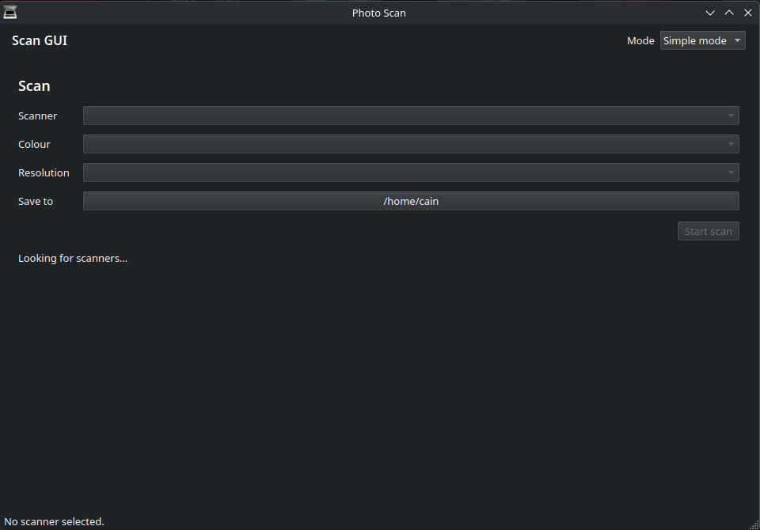
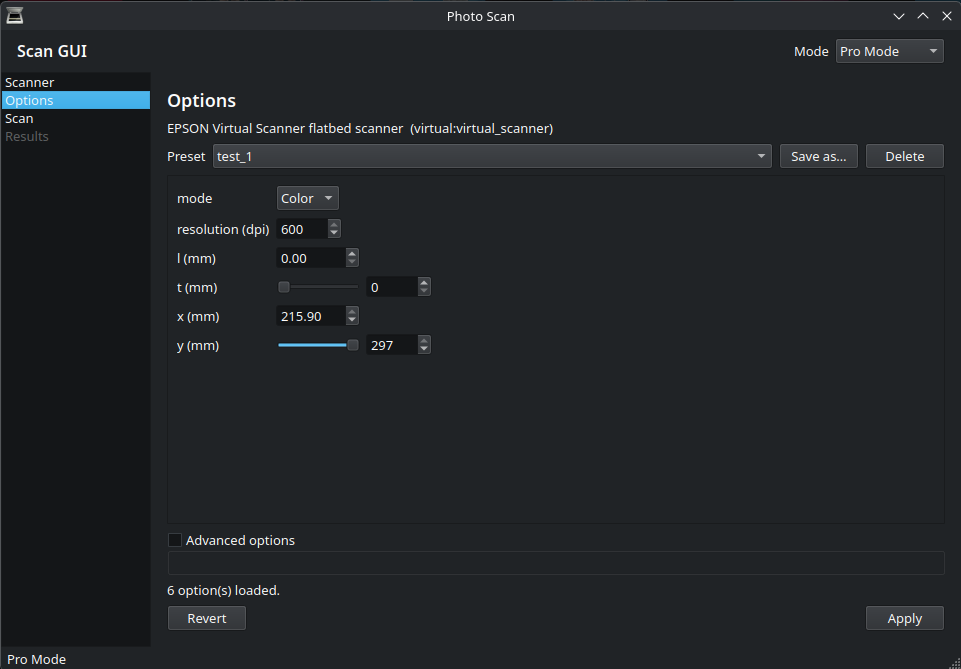

# Photo Scan

A desktop application for SANE scanners on Linux. It finds your scanner,
scans documents and photographs, and automatically detects and crops the
photographs lying on the scanner bed.



## The two modes

The **Mode** drop-down in the header switches between them; the app opens in
**Simple mode**.

### Simple mode

The everyday view — four drop-downs and a button:

```
Scanner      [ Canon PIXMA MP610 Scanner        ▾]
Colour       [ Full colour                     ▾]
Resolution   [ 1200 dpi                        ▾]
Save to      [ /home/you                       ]  (click to change)
                     [ Start scan ]
```

The colour list runs from full colour down to black and white, the
resolutions from the highest to the lowest, and only what your scanner
actually offers is shown. While the app is still looking for scanners, or
still reading their options, the controls stay greyed out and the line under
the button says what is happening (*Looking for scanners…*, *Reading the
scanner's options…*, *Ready to scan.*, *Scanning…*).

### Pro mode



The full view: a sidebar with the Scanner, Options, Scan and Results pages,
every SANE option the device exposes, presets, the scanner log and the lock
file. Pick *Pro Mode* in the Mode drop-down.

Both modes drive the same state machine and the same backend. Changing a
value in the simple mode updates the full form too, so switching modes never
loses a setting.

## Installing

### Flatpak

Once the application is published to Flathub it will be available through
Flathub and every client built on it, including Bazaar:

```bash
flatpak install flathub io.github.AHerling.photo-scan
```

### RPM (Fedora)

The package is built from the spec in this repository. From a checkout:

```bash
sudo dnf install ./photo-scan-0.2.0-1.fc44.noarch.rpm
```

It is also published as a COPR repository, which installs the same package
together with its dependencies:

```bash
sudo dnf install dnf-plugins-core
sudo dnf copr enable @<your-account>/photo-scan
sudo dnf install photo-scan
```

### From source

Photo Scan needs Python 3.12 or newer and the system packages listed below.
The dependencies are system packages on purpose: there is nothing to install
into a virtual environment.

On Fedora:

```bash
sudo dnf install python3-pyside6 python3-opencv python3-numpy \
                 sane-backends sane-airscan avahi
```

Then, from a checkout:

```bash
python3 -m scan_gui
```

or install it into the current environment:

```bash
pip install .
photo-scan
```

### What the scanner needs

| Package | What it provides |
|---|---|
| `sane-backends` | `scanimage` and the USB scanner drivers |
| `sane-airscan` | eSCL/AirScan support for network and Wi-Fi scanners |
| `avahi` | mDNS discovery, so network scanners can be found |
| `python3-pyside6` | the Qt 6 bindings |
| `python3-opencv` | the photo detection and cropping |
| `python3-numpy` | the array handling OpenCV works on |

## Permissions

### USB scanners

Most USB scanners need membership in the `scanner` and `lp` groups:

```bash
sudo usermod -aG scanner,lp "$USER"
```

Log out and back in for the group change to take effect. Without it,
`scanimage` cannot open the device.

### Network scanners

Network scanners advertise themselves over mDNS. AirScan is the recommended
backend for them; after installing `sane-airscan`, `scanimage -L` discovers
them on its own.

If discovery is slow or a scanner is missing:

* check that the Avahi daemon is running: `systemctl enable --now avahi-daemon`;
* make sure the scanner and the computer are on the same network;
* check the firewall.

USB scanners and the older `net` and `saned` backends work as they always
did.

## Using it

The **Scanner** page lists the devices reported by `scanimage -L`; pick one
and the **Options** page is filled with the scanner's own options, read from
`scanimage -A`. Options can be changed, applied, and stored as named presets.

`scanimage -L` takes a few seconds to probe the backends, so the device list
appears after a short delay.

The **Scan** page starts a scan with the options from the **Options** page:
the raw TIFF goes to the output folder as `000001.tiff`, `000002.tiff`, …, the
progress bar is fed by `scanimage --progress`, and Cancel kills the scanner.
A lock file keeps two scans from colliding.

When the scan finishes, the **Results** page looks for photographs in the
scanned image and cuts them out. The photos are written to the photo folder
as `000001.jpg`, `000002.jpg`, … and previewed in a thumbnail grid; the app
switches to that page on its own. Detection runs in a background thread, so
the window stays responsive, and a page without photographs simply says so.

Settings are stored as JSON in `~/.config/scan-gui/config.json`: the last
device, the output folders and the saved presets.

Photo Scan is a desktop application and has no command line interface.

## Development

```bash
python3 -m unittest discover -s tests -v
```

The tests run against captured `scanimage` output fixtures, so no scanner is
needed. The `tests/fixtures` folder holds one real capture
(`scanimage_A_virtual.txt`, from sane-backends' virtual scanner) and one
hand-written fixture (`scanimage_A_pixma.txt`) that mimics the layout of a
Canon PIXMA. The photo tests build synthetic pages (a white sheet with dark
rectangles) and run them through the real OpenCV pipeline, so detection and
cropping are covered without hardware as well.

See [docs/ARCHITECTURE.md](docs/ARCHITECTURE.md) for how the code is put
together, and [CHANGELOG.md](CHANGELOG.md) for what changed.

## Packaging

| Format | Where |
|---|---|
| Flatpak | [`packaging/FLATPAK_MANIFEST_GUIDE.md`](packaging/FLATPAK_MANIFEST_GUIDE.md) — the manifest is written by hand, see [`FLATHUB_PACKAGING.md`](FLATHUB_PACKAGING.md) |
| RPM | [`photo-scan.spec`](photo-scan.spec) |

Desktop integration files live in `data/`: the desktop entry, the AppStream
metainfo, the icon and the store screenshots. They are all named after the
application ID, `io.github.AHerling.photo-scan`.

## License

MIT — see [LICENSE](LICENSE).

The AppStream metadata is licensed under CC0-1.0, as AppStream requires.

## A note on AI assistance

Parts of this repository, including the packaging metadata and the
documentation, were written with the help of an AI assistant. The changes
were reviewed and are the responsibility of the maintainer. Commits made
with that help carry an `Assisted-by:` trailer.
